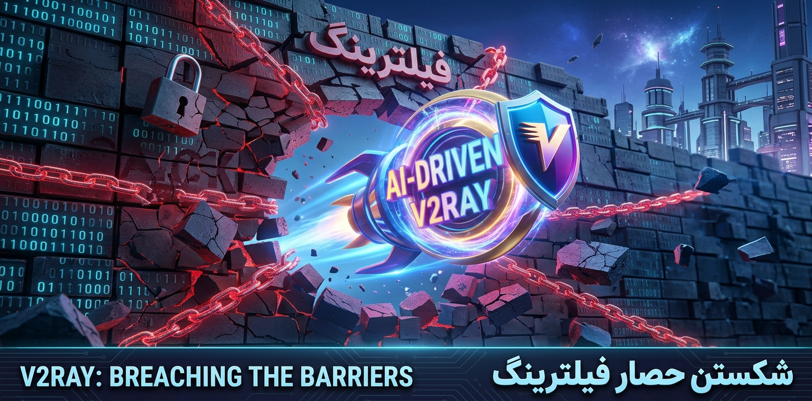

<p align="center">
  <a href="https://alireza786786.github.io/ai-driven-v2ray/">
    
  </a>
</p>

<p align="center">
  <b>GOODBAYE · PASSAGE STANDARD</b>
  <br>
  <sub>Numbers from a real run, not a promise. · <a href="README_FA.md">نسخهٔ فارسی</a></sub>
</p>

<p align="center">
  <a href="https://github.com/alireza786786/ai-driven-v2ray/actions/workflows/aggregate.yml"></a>
  <a href="https://raw.githubusercontent.com/alireza786786/ai-driven-v2ray/main/index.json"></a>
  <a href="https://raw.githubusercontent.com/alireza786786/ai-driven-v2ray/main/health.json"></a>
  <a href="https://raw.githubusercontent.com/alireza786786/ai-driven-v2ray/main/health.json"></a>
  <a href="https://raw.githubusercontent.com/alireza786786/ai-driven-v2ray/main/health.json"></a>
</p>

**Passage** is an automated pipeline, not a hand-curated list. Every 45 minutes it reads raw configs from 13 GitHub sources, removes duplicates, checks TCP reachability, then makes a real HTTP request through each surviving proxy — three separate rounds. Only configs that pass every round are marked verified and reach the recommended tiers; the raw `all` bucket is published too, clearly labelled as mostly untested.

> Badges read `index.json` and `health.json` live, so they cannot go stale. The numbers written in the prose below are a dated snapshot; `health.json` is always the source of truth.

---

## Quick start

**Top 100** — verified configs sorted by median delay, capped at 100. Never padded with untested entries:

```text
https://raw.githubusercontent.com/alireza786786/ai-driven-v2ray/main/top100.txt
```

**All verified** — the same standard, no cap:

```text
https://raw.githubusercontent.com/alireza786786/ai-driven-v2ray/main/verified/configs_base64.txt
```

**Web panel** — live counts, per-country search, copy buttons, QR codes, light/dark themes: [alireza786786.github.io/ai-driven-v2ray](https://alireza786786.github.io/ai-driven-v2ray/)

<table>
  <tr>
    <td align="center"><a href="https://alireza786786.github.io/ai-driven-v2ray/"></a><br><sub>Panel</sub></td>
    <td align="center"><a href="https://raw.githubusercontent.com/alireza786786/ai-driven-v2ray/main/top100.txt"></a><br><sub>Top 100</sub></td>
    <td align="center"><a href="https://raw.githubusercontent.com/alireza786786/ai-driven-v2ray/main/verified/configs_base64.txt"></a><br><sub>Verified</sub></td>
    <td align="center"><a href="https://t.me/Goodbaye_filtering"></a><br><sub>Channel</sub></td>
  </tr>
</table>

Each QR encodes the subscription URL itself, so the client fetches a fresh list on every refresh.

---

## Tiers

All six tiers come from one pool, filtered by increasing evidence. Each ships as `txt`, `b64`, `yaml` (mihomo/Clash) and `json` (sing-box).

| Tier | Criterion | 2026-10-30 run | Formats |
| :--- | :--- | ---: | :--- |
| **verified** | real proxied request succeeded in all 3 L3 rounds — recommended | 1,656 | [txt](https://raw.githubusercontent.com/alireza786786/ai-driven-v2ray/main/verified/configs.txt) · [b64](https://raw.githubusercontent.com/alireza786786/ai-driven-v2ray/main/verified/configs_base64.txt) · [yaml](https://raw.githubusercontent.com/alireza786786/ai-driven-v2ray/main/verified/clash.yaml) · [json](https://raw.githubusercontent.com/alireza786786/ai-driven-v2ray/main/verified/singbox.json) |
| **fast** | verified AND median delay below the threshold (800 ms in this run) | 1,022 | [txt](https://raw.githubusercontent.com/alireza786786/ai-driven-v2ray/main/fast/configs.txt) · [b64](https://raw.githubusercontent.com/alireza786786/ai-driven-v2ray/main/fast/configs_base64.txt) · [yaml](https://raw.githubusercontent.com/alireza786786/ai-driven-v2ray/main/fast/clash.yaml) · [json](https://raw.githubusercontent.com/alireza786786/ai-driven-v2ray/main/fast/singbox.json) |
| **secure** | verified AND forward secrecy, certificate validation not disabled | 1,185 | [txt](https://raw.githubusercontent.com/alireza786786/ai-driven-v2ray/main/secure/configs.txt) · [b64](https://raw.githubusercontent.com/alireza786786/ai-driven-v2ray/main/secure/configs_base64.txt) · [yaml](https://raw.githubusercontent.com/alireza786786/ai-driven-v2ray/main/secure/clash.yaml) · [json](https://raw.githubusercontent.com/alireza786786/ai-driven-v2ray/main/secure/singbox.json) |
| **all** | everything after de-duplication — largest list, mostly untested | 11,035 | [txt](https://raw.githubusercontent.com/alireza786786/ai-driven-v2ray/main/all/configs.txt) · [b64](https://raw.githubusercontent.com/alireza786786/ai-driven-v2ray/main/all/configs_base64.txt) · [yaml](https://raw.githubusercontent.com/alireza786786/ai-driven-v2ray/main/all/clash.yaml) · [json](https://raw.githubusercontent.com/alireza786786/ai-driven-v2ray/main/all/singbox.json) |
| **light** | the 8 light sources only | 5,242 | [txt](https://raw.githubusercontent.com/alireza786786/ai-driven-v2ray/main/light/configs.txt) · [b64](https://raw.githubusercontent.com/alireza786786/ai-driven-v2ray/main/light/configs_base64.txt) · [yaml](https://raw.githubusercontent.com/alireza786786/ai-driven-v2ray/main/light/clash.yaml) · [json](https://raw.githubusercontent.com/alireza786786/ai-driven-v2ray/main/light/singbox.json) |
| **heavy** | the 5 heavy sources only | 7,000 | [txt](https://raw.githubusercontent.com/alireza786786/ai-driven-v2ray/main/heavy/configs.txt) · [b64](https://raw.githubusercontent.com/alireza786786/ai-driven-v2ray/main/heavy/configs_base64.txt) · [yaml](https://raw.githubusercontent.com/alireza786786/ai-driven-v2ray/main/heavy/clash.yaml) · [json](https://raw.githubusercontent.com/alireza786786/ai-driven-v2ray/main/heavy/singbox.json) |

`light` and `heavy` overlap and are not additive. Every `yaml` and `json` is checked with the real binaries before publishing (`mihomo -t`, `sing-box check`); results land in `validation.json`.

`top100.txt` is a slice of `verified`, not a seventh tier: sorted by median delay and capped at 100.

---

## The cascade

| Gate | Question | Cost | This run |
| :--- | :--- | :--- | ---: |
| **L0/L1 — structure** | Parses? Endpoint unique? Routable? | no network | 10,590 of 11,035 |
| **L2 — reachability** | Does the TCP port actually accept connections? | separate DNS + 800 concurrent connects, 3 s each | 6,870 open |
| **L3 — passage** | Does a real HTTP request through the proxy succeed? | xray-knife, 3 rounds, 5 s per config | 1,881 once · 1,656 all three |
| **Buckets** | Which passed every round? Which are fast? Which are secure? | sort/compare only | 1,022 fast · 1,185 secure · top 100 |

> **Snapshot:** 2026-10-30 00:08 UTC, from a GitHub runner in the US (Cloudflare colo `SEA`). The cascade took 254.97 s: L0/L1 0.52 s, L2 32.93 s, three L3 rounds 220.41 s. `health.json` records this for every run; trust it over this README.

Funnel for that run: 20,132 raw fetched → 11,035 unique after de-duplication (100%) → 10,590 structurally valid (96.0%) → 6,870 TCP-open (62.3%) → 1,881 worked at least once (17.0%) → 1,656 stable in all three rounds (15.0%).

The per-round successes were 1,764 / 1,796 / 1,789, yet only 1,656 configs were present in all three sets. That means 225 configs — 11.96% of everything that ever worked — are flaky. Publishing after a single round would have shipped all 225 as "healthy".

These percentages are about one vantage point, not your connection. A config that fails from Virginia may work from Tehran and vice versa. "Verified" means "answered a real request from the test machine at test time", not "guaranteed for you".

---

## Protocols

Files are split out of `all/` and only published when non-empty. A 404 means "nothing of this protocol in this run" — never an empty subscription that wipes a client list.

| Protocol | 2026-10-30 run | Plain | Base64 |
| :--- | ---: | :--- | :--- |
| VLESS | 4,623 | [txt](https://raw.githubusercontent.com/alireza786786/ai-driven-v2ray/main/protocols/vless.txt) | [b64](https://raw.githubusercontent.com/alireza786786/ai-driven-v2ray/main/protocols/vless_base64.txt) |
| VMess | 3,555 | [txt](https://raw.githubusercontent.com/alireza786786/ai-driven-v2ray/main/protocols/vmess.txt) | [b64](https://raw.githubusercontent.com/alireza786786/ai-driven-v2ray/main/protocols/vmess_base64.txt) |
| Trojan | 1,660 | [txt](https://raw.githubusercontent.com/alireza786786/ai-driven-v2ray/main/protocols/trojan.txt) | [b64](https://raw.githubusercontent.com/alireza786786/ai-driven-v2ray/main/protocols/trojan_base64.txt) |
| Shadowsocks | 996 | [txt](https://raw.githubusercontent.com/alireza786786/ai-driven-v2ray/main/protocols/shadowsocks.txt) | [b64](https://raw.githubusercontent.com/alireza786786/ai-driven-v2ray/main/protocols/shadowsocks_base64.txt) |
| Hysteria 2 | 269 | [txt](https://raw.githubusercontent.com/alireza786786/ai-driven-v2ray/main/protocols/hysteria2.txt) | [b64](https://raw.githubusercontent.com/alireza786786/ai-driven-v2ray/main/protocols/hysteria2_base64.txt) |
| SOCKS | 3 | [txt](https://raw.githubusercontent.com/alireza786786/ai-driven-v2ray/main/protocols/socks.txt) | [b64](https://raw.githubusercontent.com/alireza786786/ai-driven-v2ray/main/protocols/socks_base64.txt) |
| ShadowsocksR | 1 | [txt](https://raw.githubusercontent.com/alireza786786/ai-driven-v2ray/main/protocols/shadowsocksr.txt) | [b64](https://raw.githubusercontent.com/alireza786786/ai-driven-v2ray/main/protocols/shadowsocksr_base64.txt) |

The parser also understands `hysteria`, `tuic`, `wireguard`, `juicity`, `anytls`, `snell` and `mieru`; none appeared in this run. The live list of published files is `protocol_files` in `index.json`; `protocol_files_mirror` lists their `servers/` twins.

Two older names keep working. `servers/` mirrors every published pair from `protocols/`, with `socks5.txt` as the historical name for `socks.txt`; `all_servers.txt` is a byte-identical copy of `all/configs.txt` kept because users have copied that link. Both follow the same rule as everything else — an empty file is never published, so a 404 means "nothing this run".

---

## Countries

55 countries, all from verified configs, located by GeoIP (DB-IP Country Lite). One file per non-empty country. The index is the canonical list of filenames:

- [`Countries/index.json`](https://raw.githubusercontent.com/alireza786786/ai-driven-v2ray/main/Countries/index.json)
- Examples: [`United_States.txt`](https://raw.githubusercontent.com/alireza786786/ai-driven-v2ray/main/Countries/United_States.txt) (354), [`Canada.txt`](https://raw.githubusercontent.com/alireza786786/ai-driven-v2ray/main/Countries/Canada.txt) (270), [`The_Netherlands.txt`](https://raw.githubusercontent.com/alireza786786/ai-driven-v2ray/main/Countries/The_Netherlands.txt) (241), [`Germany.txt`](https://raw.githubusercontent.com/alireza786786/ai-driven-v2ray/main/Countries/Germany.txt) (136).

Use the names from the index; for example it is `The_Netherlands.txt`, not `Netherlands.txt`.

---

## Web panel

<a href="https://alireza786786.github.io/ai-driven-v2ray/"></a>

A static page published from `docs/` only. It fetches data in the browser from `raw.githubusercontent.com`, falls back to jsDelivr after 15 seconds, and stores nothing server-side. It shows live counts and the last-run timestamp, an explicit stale-data banner, the quality ladder, category/protocol/country search with copy buttons, a top-100 preview, a source-health table and QR dialogs.

---

## One-line remark

Every node is rebranded to a single line — not five:

```text
CA 🇨🇦 | @Goodbaye_filtering | 8F8AB8
US 🇺🇸 | @Goodbaye_filtering | 22A072
```

Format: `{CC} {flag} | @Goodbaye_filtering | {tag}`. The tag is derived from the config itself, not from its line number, so adding a config does not shift every later remark. Single-line remarks also survive clients that mishandle multi-line fragments.

---

## raw vs mirror

| Host | Cache | Worst-case staleness |
| :--- | :--- | :--- |
| `raw.githubusercontent.com` | ~5 min | 5 minutes |
| `cdn.jsdelivr.net` (branch ref) | up to 12 h | 12 hours — 144× slower |

Prefer raw. Use the mirror only when raw is blocked. For byte-identical pinning, use `@<commit-sha>/…` instead of a branch name. Everything lives on the default branch (`main`), so old links keep working.

---

## Metadata

| File | What it is |
| :--- | :--- |
| [`index.json`](https://raw.githubusercontent.com/alireza786786/ai-driven-v2ray/main/index.json) | Counters, run/next-run times, every file URL on raw + mirror, protocol list |
| [`health.json`](https://raw.githubusercontent.com/alireza786786/ai-driven-v2ray/main/health.json) | Per-source health, drops, GeoIP stats, full cascade report including the runner's country |
| [`state.json`](https://raw.githubusercontent.com/alireza786786/ai-driven-v2ray/main/state.json) | Rolling source-yield history and automatic disable decisions |
| [`validation.json`](https://raw.githubusercontent.com/alireza786786/ai-driven-v2ray/main/validation.json) | `sing-box check` and `mihomo -t` results |
| [`Countries/index.json`](https://raw.githubusercontent.com/alireza786786/ai-driven-v2ray/main/Countries/index.json) | Country names, codes, flags, counts and filenames |

Sources this run: 13 GitHub sources (8 light, 5 heavy), 12 healthy, 1 failed. No Telegram channel scraping is involved: the channel is an output of the pipeline, not an input.

---

## Clients

| OS | Clients |
| :--- | :--- |
| Android | v2rayNG, Hiddify, Clash Meta for Android, FlClash, sing-box |
| Windows | v2rayN, Hiddify, Clash Verge Rev, FlClash |
| iOS / iPadOS | Streisand, FoXray, V2Box, sing-box |
| macOS / Linux | Hiddify, Clash Verge Rev, FlClash |

For Base64 lists use "Import from URL" and enable auto-update. For Clash/mihomo import the `yaml`; for sing-box import the `json`.

---

## FAQ

**A "verified" config does not connect for me.** Verified means it answered a real request from a US runner at test time. Networks move; keep the list fresh and keep backups.

**fast vs secure?** Both are subsets of verified. `fast` is below the delay threshold (800 ms this run — the code default, configurable via `L3_FAST_MS`). `secure` has forward secrecy (TLS/REALITY/QUIC with (EC)DHE) and does not disable certificate validation. Speed and crypto properties are independent.

**Why do some files 404?** Empty files are never published. If a protocol or country had no configs this run, its file does not exist. That is temporary, not an empty subscription that wipes a client's list.

**How fresh is it?** The cron is every 45 minutes with a 40-minute freshness gate; GitHub can delay runs under load. The real last-run timestamp is in the panel and `health.json`.

**Is it safe?** These are public proxies with unknown operators. Do not send passwords, banking or other sensitive data through them. The repository itself sees no traffic and collects no data.

---

## Layout

```text
scripts/        pipeline: fetch, structural filter, L2, L3, output builders
src/            Telegram publishing + legacy collection (outside the main build)
docs/           static panel — the only path GitHub Pages publishes
verified/ fast/ secure/ all/ light/ heavy/
Countries/      one file per country + index.json
protocols/      one file per non-empty protocol, plus its base64 twin
servers/        compatibility mirror of protocols/ (socks -> socks5)
all_servers.txt legacy name for a copy of all/configs.txt
index.json health.json state.json validation.json top100.txt
```

---

## License & contact

- License: [MIT](LICENSE).
- Author: [alireza786786](https://github.com/alireza786786)
- Channel: [@Goodbaye_filtering](https://t.me/Goodbaye_filtering)
- Panel: [alireza786786.github.io/ai-driven-v2ray](https://alireza786786.github.io/ai-driven-v2ray/)

This is an independent project, not affiliated with any company or provider. Configs are collected from public sources; you are responsible for how you use them and for complying with local law. No server here guarantees access or security.
