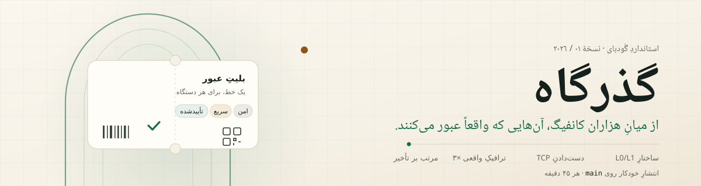
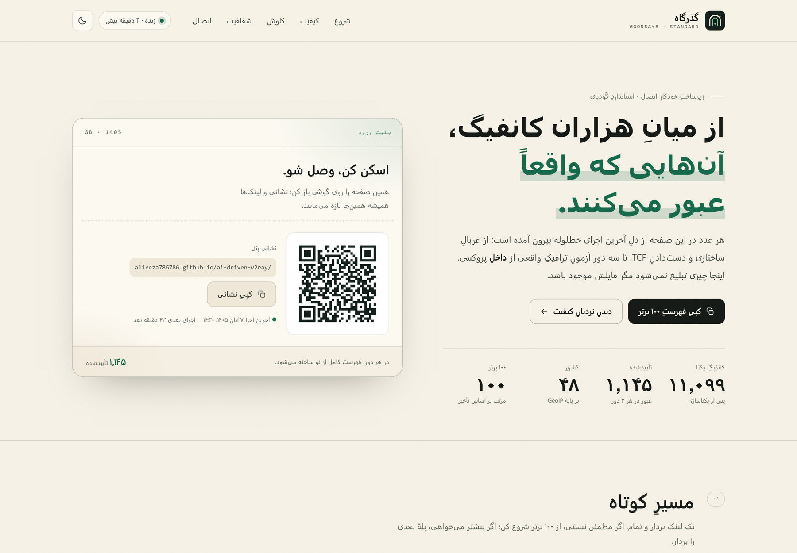

<p align="center">
  <a href="https://alireza786786.github.io/ai-driven-v2ray/">
    
  </a>
</p>

<p align="center">
  <b>گذرگاه</b> · استانداردِ گُودبای
  <br>
  <sub>هر عددِ این صفحه از یک اجرای واقعی آمده است، نه از یک وعده. · <a href="README.md">English</a></sub>
</p>

<p align="center">
  <a href="https://github.com/alireza786786/ai-driven-v2ray/actions/workflows/aggregate.yml"></a>
  <a href="https://raw.githubusercontent.com/alireza786786/ai-driven-v2ray/main/index.json"></a>
  <a href="https://raw.githubusercontent.com/alireza786786/ai-driven-v2ray/main/health.json"></a>
  <a href="https://raw.githubusercontent.com/alireza786786/ai-driven-v2ray/main/health.json"></a>
  <a href="https://raw.githubusercontent.com/alireza786786/ai-driven-v2ray/main/health.json"></a>
</p>

**گذرگاه** یک خطِ لولهٔ خودکار است، نه یک فهرستِ دستی. هر ۴۵ دقیقه کانفیگ‌های خام را از ۱۳ منبعِ گیت‌هاب می‌خواند، تکراری‌ها را دور می‌ریزد، پورتِ زنده را می‌سنجد و بعد با یک درخواستِ واقعیِ HTTP از داخلِ پروکسی — سه بارِ پشتِ‌سرهم — امتحان می‌کند. فقط آن‌هایی که هر سه بار عبور کردند «تأییدشده» می‌شوند و به دسته‌های پیشنهادی راه پیدا می‌کنند؛ دستهٔ خامِ `all` هم منتشر می‌شود، ولی صریحاً «عمدتاً تست‌نشده» برچسب می‌خورد.

> شمارنده‌های بالا از `index.json` و `health.json` خوانده می‌شوند، پس با هر اجرا خودشان را به‌روز می‌کنند. عددِ داخلِ متن‌های زیر اما عکسِ یک اجرای مشخص است؛ تاریخش را همیشه کنارش نوشته‌ایم.

---

## سه قدم تا سوار شدن

### ۱. کوتاه‌ترین راه: فهرستِ ۱۰۰ برتر

کوچک، مرتب و قابلِ اعتماد — همان کانفیگ‌های تأییدشده که بر اساسِ میانهٔ تأخیر مرتب شده‌اند و در ۱۰۰ موردِ اول بریده‌اند. این فهرست هرگز با کانفیگِ تست‌نشده پر نمی‌شود؛ اگر در یک دور کمتر از ۱۰۰ مورد تأیید شود، کوتاه می‌ماند.

```text
https://raw.githubusercontent.com/alireza786786/ai-driven-v2ray/main/top100.txt
```

### ۲. فهرستِ کاملِ تأییدشده

بیشتر می‌خواهید؟ همان استاندارد، بدونِ سقفِ ۱۰۰:

```text
https://raw.githubusercontent.com/alireza786786/ai-driven-v2ray/main/verified/configs_base64.txt
```

اگر کلاینت‌تان Base64 نمی‌خواهد، نسخهٔ سادهٔ همین فهرست در [`verified/configs.txt`](https://raw.githubusercontent.com/alireza786786/ai-driven-v2ray/main/verified/configs.txt) است.

### ۳. پنل، روی مرورگر

پنلِ آنلاین همین مخزن، همین داده‌ها را زنده می‌خواند و به‌جای کپی‌کردنِ دستیِ لینک، همه‌چیز را دسته‌بندی‌شده نشان می‌دهد: [alireza786786.github.io/ai-driven-v2ray](https://alireza786786.github.io/ai-driven-v2ray/)

<table dir="rtl">
  <tr>
    <td align="center"><a href="https://alireza786786.github.io/ai-driven-v2ray/"></a><br><sub>پنل</sub></td>
    <td align="center"><a href="https://raw.githubusercontent.com/alireza786786/ai-driven-v2ray/main/top100.txt"></a><br><sub>۱۰۰ برتر</sub></td>
    <td align="center"><a href="https://raw.githubusercontent.com/alireza786786/ai-driven-v2ray/main/verified/configs_base64.txt"></a><br><sub>تأییدشده</sub></td>
    <td align="center"><a href="https://t.me/Goodbaye_filtering"></a><br><sub>کانال</sub></td>
  </tr>
</table>

هر کیو‌آرکد خودِ نشانیِ اشتراک را رمزگذاری می‌کند، نه یک عکسِ منجمد. اسکن کنید و به‌روزرسانیِ خودکار را روشن بگذارید؛ کلاینت هر بار فهرستِ تازه می‌گیرد.

---

## انتخابِ مسیر

در هر اجرا شش دسته منتشر می‌شود. این‌ها شش منبعِ جدا نیستند؛ یک استخرِ واحدند که با سطوحِ مختلفِ شواهد غربال شده‌اند. هر دسته در چهار قالب می‌آید: `txt` (خط‌به‌خط)، `b64` (فرمتِ کلاسیکِ اشتراک)، `yaml` (پروفایلِ mihomo/Clash) و `json` (پروفایلِ sing-box).

| دسته | معیارِ ورود | همین حالا | قالب‌ها |
| :--- | :--- | ---: | :--- |
| **verified** | در هر سه دورِ L3 یک درخواستِ واقعی موفق بوده — پیشنهادی | ۱٬۱۴۵ | [txt](https://raw.githubusercontent.com/alireza786786/ai-driven-v2ray/main/verified/configs.txt) · [b64](https://raw.githubusercontent.com/alireza786786/ai-driven-v2ray/main/verified/configs_base64.txt) · [yaml](https://raw.githubusercontent.com/alireza786786/ai-driven-v2ray/main/verified/clash.yaml) · [json](https://raw.githubusercontent.com/alireza786786/ai-driven-v2ray/main/verified/singbox.json) |
| **fast** | verified و میانهٔ تأخیر زیرِ آستانه (در این اجرا: ۵۰۰ms) | ۳۴۰ | [txt](https://raw.githubusercontent.com/alireza786786/ai-driven-v2ray/main/fast/configs.txt) · [b64](https://raw.githubusercontent.com/alireza786786/ai-driven-v2ray/main/fast/configs_base64.txt) · [yaml](https://raw.githubusercontent.com/alireza786786/ai-driven-v2ray/main/fast/clash.yaml) · [json](https://raw.githubusercontent.com/alireza786786/ai-driven-v2ray/main/fast/singbox.json) |
| **secure** | verified و دارای forward secrecy، بدونِ خاموش‌کردنِ اعتبارسنجیِ گواهی | ۸۲۶ | [txt](https://raw.githubusercontent.com/alireza786786/ai-driven-v2ray/main/secure/configs.txt) · [b64](https://raw.githubusercontent.com/alireza786786/ai-driven-v2ray/main/secure/configs_base64.txt) · [yaml](https://raw.githubusercontent.com/alireza786786/ai-driven-v2ray/main/secure/clash.yaml) · [json](https://raw.githubusercontent.com/alireza786786/ai-driven-v2ray/main/secure/singbox.json) |
| **all** | همه‌چیز پس از حذفِ تکراری — بزرگ‌ترین فهرست، عمدتاً تست‌نشده | ۱۱٬۰۹۹ | [txt](https://raw.githubusercontent.com/alireza786786/ai-driven-v2ray/main/all/configs.txt) · [b64](https://raw.githubusercontent.com/alireza786786/ai-driven-v2ray/main/all/configs_base64.txt) · [yaml](https://raw.githubusercontent.com/alireza786786/ai-driven-v2ray/main/all/clash.yaml) · [json](https://raw.githubusercontent.com/alireza786786/ai-driven-v2ray/main/all/singbox.json) |
| **light** | فقط هشت منبعِ سبک | ۵٬۱۷۰ | [txt](https://raw.githubusercontent.com/alireza786786/ai-driven-v2ray/main/light/configs.txt) · [b64](https://raw.githubusercontent.com/alireza786786/ai-driven-v2ray/main/light/configs_base64.txt) · [yaml](https://raw.githubusercontent.com/alireza786786/ai-driven-v2ray/main/light/clash.yaml) · [json](https://raw.githubusercontent.com/alireza786786/ai-driven-v2ray/main/light/singbox.json) |
| **heavy** | فقط پنج منبعِ پرحجم | ۷٬۱۷۷ | [txt](https://raw.githubusercontent.com/alireza786786/ai-driven-v2ray/main/heavy/configs.txt) · [b64](https://raw.githubusercontent.com/alireza786786/ai-driven-v2ray/main/heavy/configs_base64.txt) · [yaml](https://raw.githubusercontent.com/alireza786786/ai-driven-v2ray/main/heavy/clash.yaml) · [json](https://raw.githubusercontent.com/alireza786786/ai-driven-v2ray/main/heavy/singbox.json) |

`light` و `heavy` زیرمجموعه‌هایی از `all` هستند، نه دو استخرِ جدا؛ جمع‌شان با `all` برابر نمی‌شود.

**کدام قالب؟** برای کلاینت‌های موبایل، `b64` امن‌ترین پیش‌فرض است. برای Clash/mihomo، فایلِ `yaml` را به‌عنوان پروفایل وارد کنید و برای sing-box، فایلِ `json` را. هر چهار قالب پیش از انتشار با باینریِ واقعی بررسی می‌شوند: `sing-box check` روی JSON و `mihomo -t` روی YAML. نتیجهٔ این بررسی در `validation.json` ثبت می‌شود.

### فهرستِ ۱۰۰ برتر، جدا از دسته‌ها

`top100.txt` یک دستهٔ هفتم نیست؛ برشی از `verified` است که بر اساسِ میانهٔ تأخیر مرتب و به ۱۰۰ مورد محدود شده. ستونِ «۱۰۰ برتر» در پنل هم همین فهرست را نشان می‌دهد.

---

## آناتومیِ یک عبور

هیچ منبعی موردِ اعتماد نیست. هر دروازه آن‌قدر ارزان است که روی کلِ استخر اجرا شود، و هر کدام کاری را دور می‌ریزد که دروازهٔ بعدی رویش هزینه می‌کرد.

| دروازه | پرسشی که می‌پرسد | هزینه | نتیجهٔ این اجرا |
| :--- | :--- | :--- | ---: |
| **L0/L1 — ساختار** | قابلِ پارس است؟ endpoint یکتاست؟ آدرس قابلِ مسیریابی است؟ | بدونِ شبکه | ۱۰٬۶۶۲ از ۱۱٬۰۹۹ |
| **L2 — دست‌دادن** | آیا پورتِ TCP واقعاً اتصال را می‌پذیرد؟ | DNS جدا + ۸۰۰ اتصالِ هم‌زمان، ۳ ثانیه برای هر endpoint | ۶٬۹۸۵ باز |
| **L3 — عبور** | آیا یک درخواستِ واقعیِ HTTP از داخلِ پروکسی پاسخ می‌گیرد؟ | `xray-knife`، سه دور، ۵ ثانیه برای هر کانفیگ | ۱٬۶۶۳ یک‌بار · ۱٬۱۴۵ هر سه بار |
| **دسته‌بندی** | کدام‌ها در هر سه دور قبول شدند؟ سریع‌ترها کدام‌اند؟ امن‌ها کدام‌اند؟ | فقط مرتب‌سازی و مقایسه | ۳۴۰ سریع · ۸۲۶ امن · ۱۰۰ برتر |

> **عکسِ لحظه‌ای:** اجرای ۶ آبان ۱۴۰۵ (۲۸ اکتبر ۲۰۲۶)، ساعتِ ۱۷:۴۸ UTC، از یک رانرِ گیت‌هاب در آمریکا (کلویِ Cloudflare: `ORD`). کلِ آبشار ۲۷۶٫۹۴ ثانیه طول کشید: L0/L1 حدودِ ۰٫۲۴ ثانیه، L2 حدودِ ۲۴٫۰۶ ثانیه و سه دورِ L3 حدودِ ۲۵۲٫۲۷ ثانیه. تاریخ و اعدادِ دقیقِ هر اجرا در `health.json` می‌ماند؛ اگر این README قدیمی شد، آن فایل قدیمی نمی‌شود.

### قیف، روی همان اجرا

| مرحله | کانفیگ | سهم از استخرِ یکتا |
| :--- | ---: | ---: |
| واکشیِ خام از ۱۳ منبع | ۱۹٬۹۵۲ | — |
| حذفِ ۸٬۸۳۱ موردِ تکراری | ۱۱٬۰۹۹ | ۱۰۰٪ |
| ساختارِ معتبر (L0/L1) | ۱۰٬۶۶۲ | ۹۶٫۱٪ |
| پورتِ باز (L2) | ۶٬۹۸۵ | ۶۲٫۹٪ |
| حداقل یک عبورِ واقعی (L3) | ۱٬۶۶۳ | ۱۵٫۰٪ |
| عبور در هر سه دور ← `verified` | ۱٬۱۴۵ | ۱۰٫۳٪ |
| زیرِ آستانهٔ سرعت ← `fast` | ۳۴۰ | ۳٫۱٪ |
| دارای forward secrecy ← `secure` | ۸۲۶ | ۷٫۴٪ |

سه دورِ L3 به‌تنهایی ۱٬۳۹۱ و ۱٬۴۳۱ و ۱٬۴۶۴ موفقیت برگرداندند، اما فقط ۱٬۱۴۵ کانفیگ در هر سه مجموعه حاضر بود. یعنی ۵۱۸ کانفیگ — ۳۱٫۱۵٪ از هر چیزی که حداقل یک‌بار کار کرد — لرزان است. اگر فقط یک دور تست می‌کردیم، همهٔ آن ۵۱۸ مورد را هم به‌عنوان «سالم» تحویل می‌دادیم.

**این درصدها دربارهٔ اتصالِ شما حرف نمی‌زنند.** آزمون از یک ماشین در آمریکا انجام شده؛ کانفیگی که آنجا شکست می‌خورد ممکن است از تهران عالی کار کند و برعکس. «تأییدشده» یعنی «در لحظهٔ آزمون، از داخلِ همان ماشین، یک درخواستِ واقعی پاسخ داد» — نه «برای شما تضمینی است».

---

## پروتکل‌ها

فایل‌ها از `all` جدا می‌شوند و فقط وقتی منتشر می‌شوند که خالی نباشند. اگر پروتکلی در یک دور هیچ کانفیگی نداشته باشد، فایلش وجود ندارد و نشانی‌اش ۴۰۴ می‌دهد؛ این یعنی «این دور چیزی از این پروتکل نبود»، نه «اشتراکِ خالی» که فهرستِ کلاینت را پاک کند.

| پروتکل | همین حالا | ساده | Base64 |
| :--- | ---: | :--- | :--- |
| VLESS | ۵٬۰۰۷ | [txt](https://raw.githubusercontent.com/alireza786786/ai-driven-v2ray/main/protocols/vless.txt) | [b64](https://raw.githubusercontent.com/alireza786786/ai-driven-v2ray/main/protocols/vless_base64.txt) |
| VMess | ۳٬۴۲۵ | [txt](https://raw.githubusercontent.com/alireza786786/ai-driven-v2ray/main/protocols/vmess.txt) | [b64](https://raw.githubusercontent.com/alireza786786/ai-driven-v2ray/main/protocols/vmess_base64.txt) |
| Trojan | ۱٬۳۹۲ | [txt](https://raw.githubusercontent.com/alireza786786/ai-driven-v2ray/main/protocols/trojan.txt) | [b64](https://raw.githubusercontent.com/alireza786786/ai-driven-v2ray/main/protocols/trojan_base64.txt) |
| Shadowsocks | ۱٬۰۲۹ | [txt](https://raw.githubusercontent.com/alireza786786/ai-driven-v2ray/main/protocols/shadowsocks.txt) | [b64](https://raw.githubusercontent.com/alireza786786/ai-driven-v2ray/main/protocols/shadowsocks_base64.txt) |
| Hysteria 2 | ۲۴۰ | [txt](https://raw.githubusercontent.com/alireza786786/ai-driven-v2ray/main/protocols/hysteria2.txt) | [b64](https://raw.githubusercontent.com/alireza786786/ai-driven-v2ray/main/protocols/hysteria2_base64.txt) |
| SOCKS | ۳ | [txt](https://raw.githubusercontent.com/alireza786786/ai-driven-v2ray/main/protocols/socks.txt) | [b64](https://raw.githubusercontent.com/alireza786786/ai-driven-v2ray/main/protocols/socks_base64.txt) |
| TUIC | ۲ | [txt](https://raw.githubusercontent.com/alireza786786/ai-driven-v2ray/main/protocols/tuic.txt) | [b64](https://raw.githubusercontent.com/alireza786786/ai-driven-v2ray/main/protocols/tuic_base64.txt) |
| ShadowsocksR | ۱ | [txt](https://raw.githubusercontent.com/alireza786786/ai-driven-v2ray/main/protocols/shadowsocksr.txt) | [b64](https://raw.githubusercontent.com/alireza786786/ai-driven-v2ray/main/protocols/shadowsocksr_base64.txt) |

پارسر پروتکل‌های `hysteria`، `wireguard`، `juicity`، `anytls`، `snell` و `mieru` را هم می‌شناسد، ولی در این دور هیچ کانفیگی از آن‌ها نبود. فهرستِ همیشه‌به‌روزِ فایل‌های موجود، کلیدِ `protocol_files` در `index.json` است.

---

## کشورها

۴۸ کشور، همه از میانِ کانفیگ‌های تأییدشده و بر اساسِ موقعیتِ واقعیِ شبکه (GeoIP با پایگاهِ DB-IP Country Lite). یک فایل برای هر کشور؛ کشورهایی که در این دور کانفیگ نداشتند، فایل ندارند.

| کشور | تعداد | فایل |
| :--- | ---: | :--- |
| United States | ۲۹۳ | [`Countries/United_States.txt`](https://raw.githubusercontent.com/alireza786786/ai-driven-v2ray/main/Countries/United_States.txt) |
| The Netherlands | ۲۴۴ | [`Countries/The_Netherlands.txt`](https://raw.githubusercontent.com/alireza786786/ai-driven-v2ray/main/Countries/The_Netherlands.txt) |
| Germany | ۹۴ | [`Countries/Germany.txt`](https://raw.githubusercontent.com/alireza786786/ai-driven-v2ray/main/Countries/Germany.txt) |
| Canada | ۸۸ | [`Countries/Canada.txt`](https://raw.githubusercontent.com/alireza786786/ai-driven-v2ray/main/Countries/Canada.txt) |
| Singapore | ۶۸ | [`Countries/Singapore.txt`](https://raw.githubusercontent.com/alireza786786/ai-driven-v2ray/main/Countries/Singapore.txt) |
| Hong Kong | ۳۵ | [`Countries/Hong_Kong.txt`](https://raw.githubusercontent.com/alireza786786/ai-driven-v2ray/main/Countries/Hong_Kong.txt) |
| France | ۳۱ | [`Countries/France.txt`](https://raw.githubusercontent.com/alireza786786/ai-driven-v2ray/main/Countries/France.txt) |
| Japan | ۲۴ | [`Countries/Japan.txt`](https://raw.githubusercontent.com/alireza786786/ai-driven-v2ray/main/Countries/Japan.txt) |
| United Kingdom | ۲۳ | [`Countries/United_Kingdom.txt`](https://raw.githubusercontent.com/alireza786786/ai-driven-v2ray/main/Countries/United_Kingdom.txt) |
| Finland | ۲۲ | [`Countries/Finland.txt`](https://raw.githubusercontent.com/alireza786786/ai-driven-v2ray/main/Countries/Finland.txt) |

فهرستِ کاملِ ۴۸ کشور، همراه با کد، پرچم و تعداد، در [`Countries/index.json`](https://raw.githubusercontent.com/alireza786786/ai-driven-v2ray/main/Countries/index.json) است. نامِ فایل‌ها همیشه از همان ایندکس بیاورید؛ مثلاً نامِ درست `The_Netherlands.txt` است، نه `Netherlands.txt`.

---

## پنلِ آنلاین

<a href="https://alireza786786.github.io/ai-driven-v2ray/"></a>

پنل یک صفحهٔ ایستاست که فقط از `docs/` منتشر می‌شود؛ خودش داده را در مرورگر از `raw.githubusercontent.com` می‌خواند و اگر raw جواب نداد، پس از ۱۵ ثانیه سراغِ آینهٔ jsDelivr می‌رود. چیزی روی سرورِ واسط ذخیره نمی‌شود.

- شمارنده‌های زنده و تاریخِ آخرین اجرا، با هشدارِ صریح اگر داده کهنه باشد.
- نردبانِ کیفیت: همان قیفِ L0/L1 تا L3، با اعدادِ همان اجرا.
- کاوش: دسته‌ها، پروتکل‌ها و کشورها، با جست‌وجوی فارسی و کپیِ یک‌کلیکیِ نشانی.
- پیش‌نمایشِ ۱۰۰ برتر و جدولِ سلامتِ منابع، شاملِ منابعِ ناموفق.
- نمایش و بزرگ‌کردنِ کیو‌آرکدها در خودِ پنل، پوستهٔ روشن و تیره، و نشانه‌گذاریِ مناسب برای صفحه‌خوان.

---

## ریمارکِ یک‌خطی

هر نود با یک ریمارکِ کوتاه بازنویسی می‌شود، نه با پنج خط:

```text
CA 🇨🇦 | @Goodbaye_filtering | 8F8AB8
US 🇺🇸 | @Goodbaye_filtering | 22A072
```

قالب ثابت است: `{کد کشور} {پرچم} | @Goodbaye_filtering | {برچسب}`. برچسب از محتوای خودِ کانفیگ مشتق می‌شود، نه از شمارهٔ خط؛ برای همین با اضافه‌شدنِ یک کانفیگ، ریمارکِ بقیه جابه‌جا نمی‌شود. تک‌خطی‌بودن هم سلیقه نیست: بعضی کلاینت‌ها ریمارکِ چندخطی را ناقص می‌خوانند یا کلِ فایل را رد می‌کنند.

---

## raw یا آینه؟

| میزبان | کش | بدترین حالتِ کهنگی |
| :--- | :--- | :--- |
| `raw.githubusercontent.com` | حدودِ ۵ دقیقه | ۵ دقیقه |
| `cdn.jsdelivr.net` (اشاره به شاخه) | تا ۱۲ ساعت | ۱۲ ساعت — ۱۴۴ برابر کندتر |

تا می‌توانید raw را ترجیح بدهید. آینه برای وقتی است که raw در دسترس نیست، نه برای انتخابِ روزمره. اگر به نسخهٔ دقیقاً یکسان نیاز دارید، به‌جای نامِ شاخه یک کامیت را پین کنید: `@<commit-sha>/…`.

همهٔ فایل‌ها روی شاخهٔ پیش‌فرض (`main`) هستند؛ نه شاخهٔ مخفی، نه مسیرِ فصلی. نشانی‌ای که ماه‌ها پیش کپی کرده‌اید هنوز کار می‌کند.

---

## فایل‌ها برای ماشین

| فایل | چیست |
| :--- | :--- |
| [`index.json`](https://raw.githubusercontent.com/alireza786786/ai-driven-v2ray/main/index.json) | شمارنده‌ها، زمانِ اجرا و اجرای بعدی، نشانیِ همهٔ فایل‌ها روی raw و آینه، فهرستِ پروتکل‌ها |
| [`health.json`](https://raw.githubusercontent.com/alireza786786/ai-driven-v2ray/main/health.json) | سلامتِ تک‌تکِ منابع، حذفیات، آمارِ GeoIP و گزارشِ کاملِ آبشار (شاملِ کشورِ اجرا) |
| [`state.json`](https://raw.githubusercontent.com/alireza786786/ai-driven-v2ray/main/state.json) | تاریخچهٔ چرخشیِ بازدهِ منابع و تصمیم‌های خودکارِ غیرفعال‌سازی |
| [`validation.json`](https://raw.githubusercontent.com/alireza786786/ai-driven-v2ray/main/validation.json) | نتیجهٔ بررسیِ خروجی‌ها با `sing-box check` و `mihomo -t` |
| [`Countries/index.json`](https://raw.githubusercontent.com/alireza786786/ai-driven-v2ray/main/Countries/index.json) | فهرستِ کشورها با کد، پرچم، تعداد و نامِ فایل |
| [`top100.txt`](https://raw.githubusercontent.com/alireza786786/ai-driven-v2ray/main/top100.txt) | ۱۰۰ کانفیگِ تأییدشده با کمترین میانهٔ تأخیر |

---

## چه کسانی را می‌خوانیم

در این دور ۱۳ منبع خوانده شد: ۸ منبعِ سبک و ۵ منبعِ پرحجم. همه از `raw.githubusercontent.com` هستند و هیچ‌کدام «کانالِ تلگرام» نیستند؛ کانال خروجیِ انتشار است، نه منبعِ ورودی.

<details>
<summary>فهرستِ منابع و وضعیتشان در این اجرا</summary>

| منبع | لایه | کانفیگ | وضعیت |
| :--- | :--- | ---: | :--- |
| `iampedii/whitedns-sub` — `base64.txt` | light | ۲۱۲ | سالم |
| `4n0nymou3/multi-proxy-config-fetcher` — `proxy_configs.txt` | light | ۱۷۹ | سالم |
| `mahsanet/MahsaFreeConfig` — `mci/sub_1.txt` | light | ۲۳ | سالم |
| `mahsanet/MahsaFreeConfig` — `mtn/sub_1.txt` | light | ۱۵ | سالم |
| `ALIILAPRO/v2rayNG-Config` — `server.txt` | light | ۳٬۹۵۲ | سالم |
| `Au1rxx/free-vpn-subscriptions` — `v2ray-base64.txt` | light | ۱٬۷۷۷ | سالم |
| `Danialsamadi/v2go` — `AllConfigsSub.txt` | light | ۵۳۴ | سالم |
| `LalatinaHub/LatinaSub` — `sub` | light | ۵۰۰ | سالم |
| `roosterkid/openproxylist` — `V2RAY_RAW.txt` | heavy | ۱۵۰ | سالم |
| `barry-far/V2ray-Config` — `All_Configs_base64_Sub.txt` | heavy | ۸٬۰۷۶ | سالم |
| `ShadowException/VPN` — `VPN-cat` | heavy | ۱۴۳ | سالم |
| `Delta-Kronecker/V2ray-Config` — `all_configs.txt` | heavy | ۴٬۳۹۱ | سالم |
| `Epodonios/v2ray-configs` — `All_Configs_Sub.txt` | heavy | ۰ | ناموفق در این دور |

</details>

---

## کلاینت‌ها

| سیستم‌عامل | کلاینت‌های سازگار |
| :--- | :--- |
| اندروید | v2rayNG، Hiddify، Clash Meta for Android، FlClash، sing-box |
| ویندوز | v2rayN، Hiddify، Clash Verge Rev، FlClash |
| iOS / iPadOS | Streisand، FoXray، V2Box، sing-box |
| مک / لینوکس | Hiddify، Clash Verge Rev، FlClash |

برای فهرست‌های Base64 از گزینهٔ «افزودن پروفایل از لینک» استفاده کنید و به‌روزرسانیِ خودکار را روشن بگذارید. برای Clash و sing-box فایلِ `yaml` و `json` را به‌عنوان پروفایل وارد کنید.

---

## پرسش‌های تکراری

<details>
<summary>چرا یک کانفیگِ «تأییدشده» برای من وصل نمی‌شود؟</summary>

«تأییدشده» یعنی در لحظهٔ آزمون، از داخلِ یک ماشین در آمریکا، یک درخواستِ واقعی پاسخ داده است. مسیرِ شبکهٔ شما، اپراتور، زمانِ روز و خودِ سرور هر لحظه عوض می‌شوند. فهرست را تازه نگه دارید و چند گزینهٔ پشتیبان داشته باشید؛ این ماهیتِ پروکسیِ عمومی است، نه نقصِ آزمون.
</details>

<details>
<summary>تفاوتِ fast و secure چیست؟</summary>

هر دو زیرمجموعهٔ `verified` هستند. `fast` تأخیرِ میانهٔ کمتر از آستانه دارد (در این اجرا ۵۰۰ms؛ پیش‌فرضِ کد ۸۰۰ms است و با `L3_FAST_MS` تغییر می‌کند). `secure` علاوه بر تأیید، forward secrecy دارد — یعنی لایهٔ TLS/REALITY/QUIC با (EC)DHE کلید می‌سازد — و اعتبارسنجیِ گواهی را خاموش نکرده است. یکی دربارهٔ سرعت است، دیگری دربارهٔ خصوصیتِ رمزنگاری؛ می‌توانید هم‌زمان دنبالِ اشتراکی باشید که هر دو را دارد.
</details>

<details>
<summary>چرا بعضی فایل‌ها ۴۰۴ می‌دهند؟</summary>

سیاست ساده است: فایلِ خالی منتشر نمی‌شود. اگر پروتکلی در یک دور هیچ کانفیگی نداشته باشد یا کشوری خالی بماند، فایلش ساخته نمی‌شود. این یک خطای موقت است، نه اشتراکِ خالی که فهرستِ کلاینت را پاک کند. ایندکسِ همیشه‌به‌روز، در `protocol_files` و `Countries/index.json` است.
</details>

<details>
<summary>چند وقت به چند وقت به‌روز می‌شود؟</summary>

زمان‌بندی هر ۴۵ دقیقه است و یک دروازهٔ ۴۰ دقیقه‌ای از انتشارِ دادهٔ تکراری جلوگیری می‌کند. گیت‌هاب زیرِ بار می‌تواند اجرا را عقب بیندازد؛ تاریخِ واقعیِ آخرین اجرا همیشه در پنل و در `health.json` هست. اگر عددی قدیمی بود، به همان تاریخ اعتماد کنید، نه به این متن.
</details>

<details>
<summary>آیا استفاده از این پروکسی‌ها امن است؟</summary>

این‌ها سرورهای عمومی‌اند و مالکشان معلوم نیست. رمز، حسابِ بانکی، ایمیل و هر دادهٔ حساس را از مسیرِ آن‌ها رد نکنید. برای کارهای حساس، سرورِ شخصی انتخابِ امن‌تری است. خودِ مخزن هیچ ترافیکی را نمی‌بیند و هیچ داده‌ای از شما جمع نمی‌کند.
</details>

<details>
<summary>پنل به چه چیزی نیاز دارد؟</summary>

هیچ‌چیز جز یک مرورگر. صفحه ایستاست، فونت و اسکریپت را از خودش سرو می‌کند و داده را از GitHub می‌خواند. اگر GitHub در دسترس نباشد، آینهٔ jsDelivr امتحان می‌شود؛ اگر هر دو نبودند، پنل خطای صریح نشان می‌دهد و دستورِ کپیِ نشانی را از کار نمی‌اندازد.
</details>

---

## نقشهٔ مخزن

```text
scripts/        موتور: واکشی، غربالِ ساختاری، L2، L3، ساختِ خروجی‌ها
src/            پخشِ تلگرام و جمع‌آوریِ قدیمی (جدا از خطِ اصلیِ ساخت)
docs/           پنلِ ایستا؛ تنها چیزی که GitHub Pages منتشر می‌کند
verified/       کانفیگ‌های قبول‌شده در هر سه دور
fast/ secure/   زیرمجموعه‌های سریع و امن
all/ light/ heavy/
Countries/      یک فایل برای هر کشور + index.json
protocols/      یک فایل برای هر پروتکلِ غیرخالی
index.json health.json state.json validation.json top100.txt
```

---

## پروانه و همراهی

- پروانه: [MIT](LICENSE) — استفاده، تغییر و انتشار آزاد است، با حفظِ متنِ پروانه.
- سازنده: [alireza786786](https://github.com/alireza786786)
- کانال: [@Goodbaye_filtering](https://t.me/Goodbaye_filtering)
- پنل: [alireza786786.github.io/ai-driven-v2ray](https://alireza786786.github.io/ai-driven-v2ray/)

این مخزن یک پروژهٔ مستقل است و به هیچ شرکت یا ارائه‌دهندهٔ خدمات وابسته نیست. کانفیگ‌ها از منابعِ عمومی جمع‌آوری می‌شوند؛ مسئولیتِ استفاده و رعایتِ قوانینِ محلی با شماست. هیچ‌کدام از این سرورها تضمینِ دسترسی یا امنیت نمی‌دهند.
